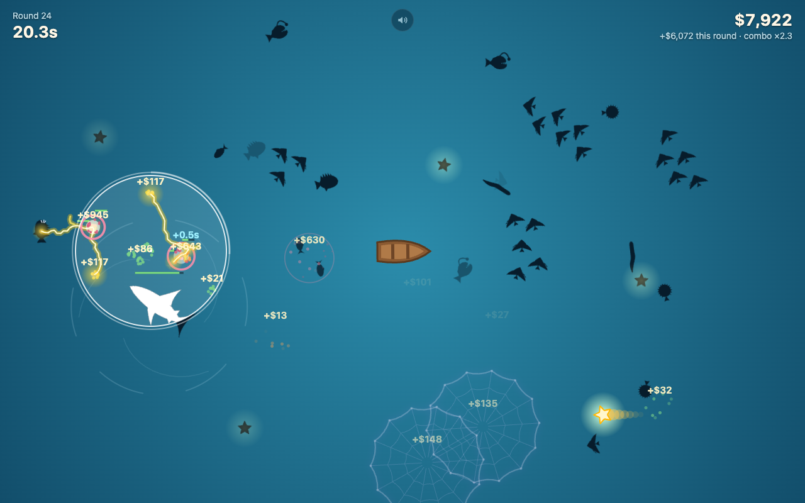
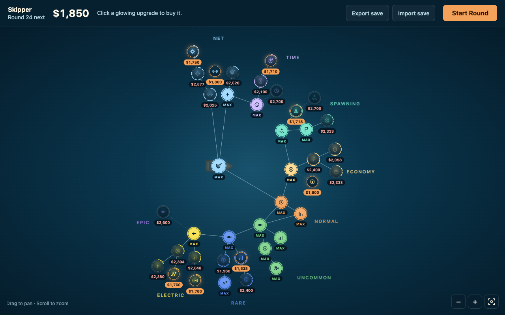
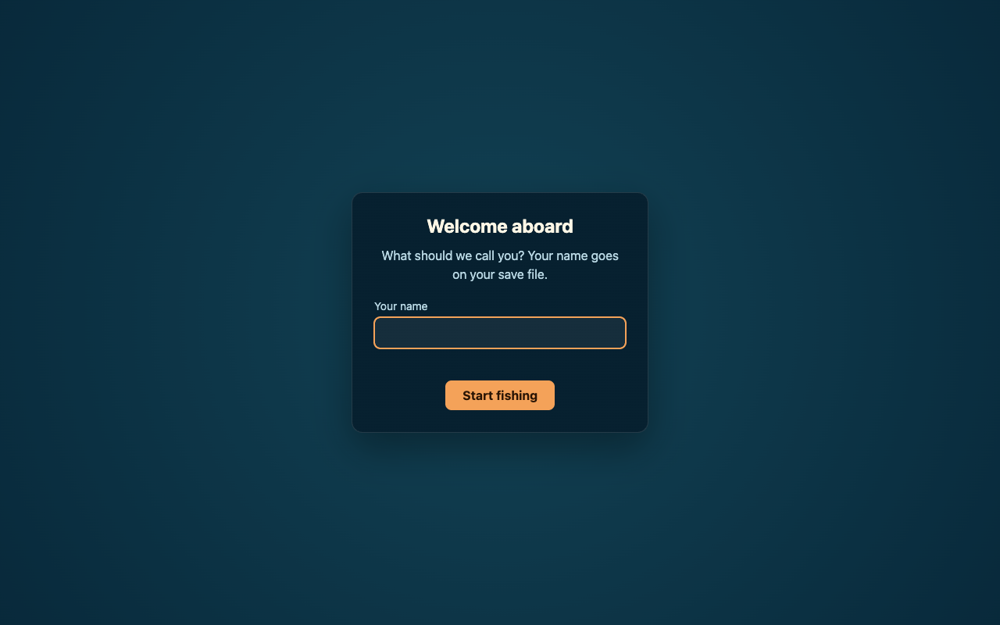
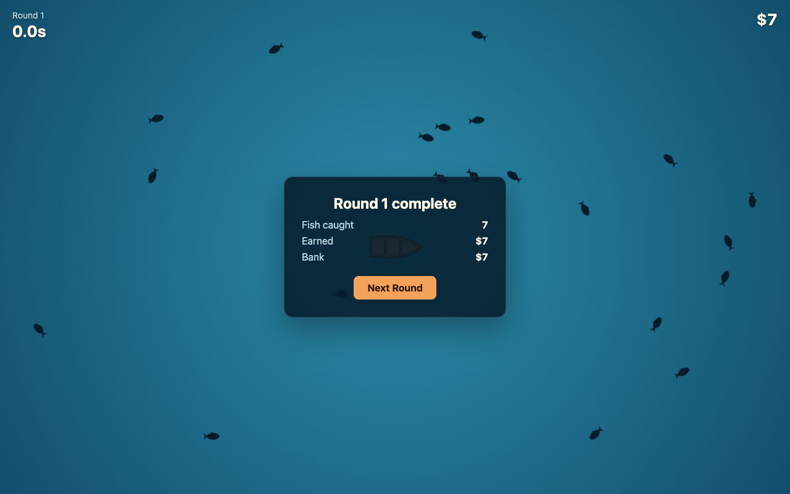
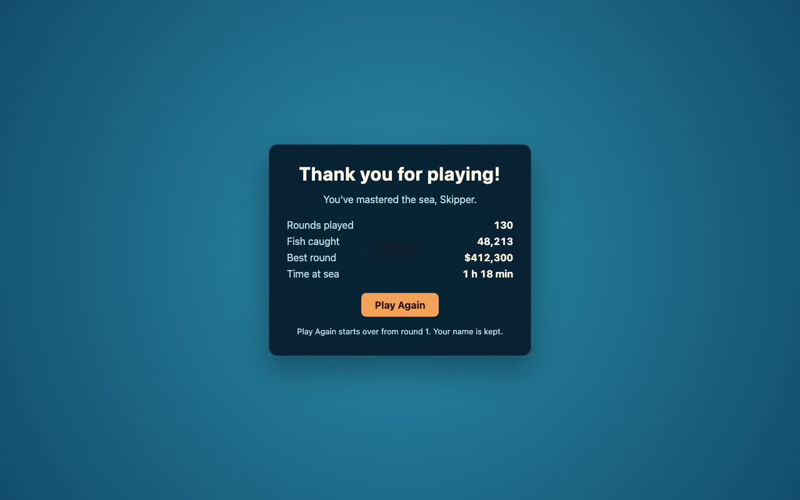

# Fishy

A round-based fish catching game for the browser. A boat sits in the middle of the sea and fish
swim around it. Your cursor carries a net that catches fish on its own; spend what you earn on
upgrades between rounds, unlock stranger fish, and work your way to the Final Round.

**Play:** https://fishy.vaibhavsomani.com/ (desktop browsers)



## How to play

- **Move the mouse.** The circle around the cursor is your net. Every half second it hits every
  fish inside it. Clicking does nothing.
- **Catch fish.** A fish whose health reaches zero is caught and pays out.
- **Beat the clock.** Each round lasts 15 seconds. Whatever you caught is banked when the timer
  runs out; fish still swimming are lost.
- **Look through the net.** Outside the net every fish is a dark silhouette, told apart by its
  outline. Inside the net you see it in full colour, with its health bar.
- **Upgrade.** Between rounds, spend money in the tech tree: a bigger net, harder hits, faster
  ticks, longer rounds, new fish and their abilities.
- **Finish.** Max out the whole tree to unlock the Final Round.
- **Sound.** Press **M**, or the speaker button, to mute. In the hub, the button next to it sets
  the music and effects volume.



| First visit | After a round | The end |
| --- | --- | --- |
|  |  |  |

## Fish

| Fish | What it does |
| --- | --- |
| Normal | The fish you start with. Steady and simple. |
| Uncommon | Swims in small schools, so one sweep can catch several. |
| Rare | Slow and armoured, but worth a lot. |
| Electric | Darts around. When caught, a current jumps from fish to fish, damaging each one. |
| Epic | Swims away from your net. When caught, it can net the fish around it. |
| Goober | Bursts into new fish when caught. Upgrades decide which kind. |
| Monster | A whirlpool: pulls nearby fish into a vortex, and when caught takes all of them with it. |
| Star | Rare. When caught it shoots across the sea, bouncing off the edges and hitting every fish in its path. |

A fish caught by any of these effects counts as caught by you, so its own ability fires too and
chains can run through the whole sea.

## Saving

Progress is saved in your browser. Export your save to a file to move it to another browser or
computer, and import it there. Sound settings are kept apart from the save: Play Again and
importing a save leave them as they are.

Full design: [docs/GAME_DESIGN.md](docs/GAME_DESIGN.md).

## Development

Requires Node 22.12+ (24 recommended, see `.nvmrc`).

```bash
npm install
npm run dev           # dev server at http://localhost:5173
npm test              # vitest
npm run typecheck
npm run build         # static site in dist/
npm run preview       # serve the build locally
npm run e2e           # play through the whole game flow in Chrome (needs Google Chrome)
npm run screenshots   # regenerate docs/screenshots (needs Google Chrome)
```

Tech tree pacing: `PACING=1 npx vitest run src/game/tech/pacing.test.ts --silent=false` plays a
whole game with a bot and reports how long the tree takes to finish.

In dev, `?fish=electric,epic` makes only those types spawn, which is handy for trying one out:
http://localhost:5173/?fish=electric,epic

Dev-only pages for working on one screen at a time: `/dev/tech-tree.html` (`?budget=N`,
`?money=N`, `?fresh`) and `/dev/save.html`.

### Structure

```
index.html          Page shell: canvas, HUD, hub, panels
src/main.ts         Boot, game loop, input, screens (hub, round, summary, end)
src/game/
  world.ts          The simulation for one round. No DOM, fixed 60 Hz step, seeded RNG
  stats.ts          Everything upgrades can change (global, per fish, abilities) and base values
  fish/             One file per fish type (FishSpec): stats, shape and behaviour hooks
    types.ts        FishSpec: onSpawn, move, modifyDamage, onCapture, update, drawWorld, fx
    index.ts        Registry of all types
  render.ts         Canvas renderer: background, boat, silhouettes, net lens, effects
  shapes.ts         Builds each type's cached full / silhouette / hit-flash sprites
  fx.ts             Short-lived visual effects that fish types add
  rng.ts            Seeded random numbers
  tech/             Tech tree: node definitions, applyUpgrades, costs, layout, pacing sim
src/save/           Save model, localStorage, validation (zod/mini), migrations, export/import
src/audio/          Music and sound effects (Web Audio); see "Music and sound" below
  index.ts          What main.ts calls: screens, purchases, each frame's world events
  engine.ts         AudioContext, mixing graph, unlock on first gesture, mute/volume, hidden tab
  music.ts          The continuous bed (loop file or generated), filter, layers, chapters, stinger
  sfx.ts            Synthesised sound effects with rate limiting
  synth.ts          Small instruments built from oscillators and noise
  loader.ts         Fetches public/audio/music.json and decodes loop files
  theory.ts, patterns.ts, mapping.ts, manifest.ts, settings.ts, gate.ts   Pure logic, tested
src/ui/             Tech tree screen, name prompt, save controls, sound controls
public/audio/       Music manifest (and loop files, once chosen)
dev/                Dev-only pages for the tech tree and save UI
scripts/
  e2e.mjs           Browser smoke test of the whole game flow
  screenshots.mjs   Captures the README screenshots
```

### Music and sound

Everything plays through Web Audio. Browsers only allow sound after a click or key press, so the
`AudioContext` is created on the first one (the name prompt for a new player, any click in the hub
for a returning one). It is suspended while muted and while the tab is hidden. Settings
(`{ muted, music, sfx }`) live in localStorage under `fishy.audio`, apart from `fishy.save`.

Everything is in one key and tempo, D major pentatonic at 92 BPM, so any note fits with any
other:

- **Music** is one continuous bed that never restarts. In the hub it is heard low-passed (700 Hz)
  and 6 dB down, as if from under water. Starting a round sweeps the filter open into the next
  downbeat, where a groove layer comes in; a combo layer (an arpeggio) follows the combo
  multiplier. A round ends with a one-bar stinger while the layers drop and the filter closes. The
  Final Round has everything open; the end screen is unfiltered and calm.
- **Chapters**: three beds, switched in the hub with a 3 s crossfade on a bar line: Shallows from
  the start, Currents once Electric fish are bought, Deep once the Monster is.
- **Until loop files are added**, each chapter plays a generated placeholder bed: a soft pad and a
  sparse marimba line whose notes are drawn bar by bar from seeded random numbers, so it never
  repeats as a loop.
- **Sound effects** are synthesised: a catch is a marimba pluck that climbs the scale with the
  combo, an Electric current rises one note per jump, a Star launches with a whoosh and bounces
  with a glass ping, a Whirlpool implodes with a noise swirl, a Goober bursts with a pop, time
  bonuses ring a tiny bell and purchases chime. Each kind is rate-limited (catches to one note per
  40 ms, at most 8 voices at once), and many catches in one frame become one fuller note.
- **Mix**: music and effects each have a volume, then master (mute), a compressor and a soft clip.
  In headless Chrome at default volumes, a quiet round measures about −28 dBFS RMS, the busiest
  late round peaks around −4 dBFS, and the Final Round with both sliders at 100% peaked at
  −1.6 dBFS.

#### Adding the loop files

The real beds are CC0 loops (e.g. from the Abstraction Music Loop Bundle), one per chapter.

1. **Pick and trim.** Choose three loops that work at a similar level. Note each one's tempo
   (BPM), key, and beats per bar. Different tempos and keys are fine: the generated layers and the
   sound effects follow whatever the manifest says.
2. **Encode** to Opus, plus AAC as a fallback for browsers that can't decode Opus (some Safari
   versions):

   ```bash
   ffmpeg -i shallows.wav -c:a libopus -b:a 96k public/audio/shallows.opus
   ffmpeg -i shallows.wav -c:a aac -b:a 128k public/audio/shallows.m4a
   ```

3. **Find the loop points.** A loop plays from the start of the file once, then repeats
   `loopStart`..`loopEnd` forever. `loopStart` must be on a downbeat: usually `0`, or where the
   repeating part begins if the file has an intro (in Audacity, set the selection toolbar to
   seconds and click the first beat of the repeat). Always give `loopEnd` explicitly, worked out
   from the music rather than the file length, because encoders pad the end of compressed files:
   `loopEnd = loopStart + bars × beatsPerBar × 60 / bpm`, e.g. 8 bars of 4/4 at 92 BPM from 0 is
   `20.8696`. The game nudges its own tempo so the loop is exactly a whole number of bars, so the
   layers stay locked to it.
4. **List them** in `public/audio/music.json`. Paths are relative to that file. A chapter left
   out or `null` keeps the generated bed:

   ```json
   {
     "chapters": [
       {
         "name": "Shallows",
         "files": ["shallows.opus", "shallows.m4a"],
         "loopStart": 0,
         "loopEnd": 20.8696,
         "bpm": 92,
         "beatsPerBar": 4,
         "key": "D major",
         "gainDb": 0
       },
       null,
       { "name": "Deep", "files": ["deep.opus", "deep.m4a"], "loopEnd": 31.304, "bpm": 92, "key": "B minor" }
     ]
   }
   ```

   | Field | Meaning |
   | --- | --- |
   | `files` | The same loop in several formats, best first. The first one the browser can play is used. An entry can be an object `{ "src", "type", "loopStart", "loopEnd" }` to give one file its own loop points, e.g. if the AAC fallback clicks at the seam because its decoder kept the encoder delay. |
   | `loopStart`, `loopEnd` | Seconds. Default `0` and the end of the file. |
   | `bpm`, `beatsPerBar` | Default 92 and 4. |
   | `key` | Like `"D major"` or `"F# minor"`; default D major. The groove, combo layer and sound effects play in its pentatonic scale. |
   | `gainDb` | Level trim so loops from different packs match; default 0. |
   | `layers` | Optional `{ "groove": [files], "combo": [files] }`: stems the same length as the bed that replace the generated groove or combo layer. |

5. **Listen.** `npm run dev`, click once, and play through a round. Problems with the manifest show
   up as console warnings starting `Fishy music:`. Only the current and next chapter are loaded,
   after the first click, and decoded audio is large (about 20 MB per minute of stereo), so keep
   loops under a minute or so.

**Credits.** CC0 needs no credit, though a line here is a kind touch: `Music: <pack> by <artist>
(CC0)`. If a track under any other licence is ever used (e.g. CC BY), it must be credited here,
for example: `"<title>" by <artist> (<link>), licensed under CC BY 4.0
(https://creativecommons.org/licenses/by/4.0/).`

### Deploy

Every push to `main` runs the tests, builds, and deploys `dist/` to GitHub Pages
(`.github/workflows/deploy.yml`). The repo's Pages source must be set to "GitHub Actions".

Saves live in the browser's localStorage, which is tied to the site's exact origin. Changing the
domain later means players have to export and re-import their saves.
