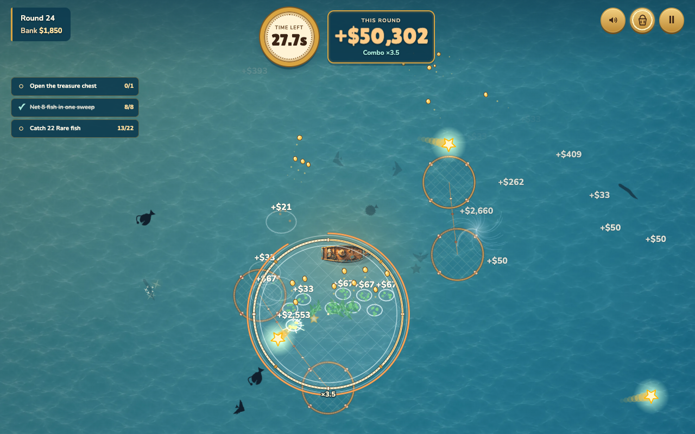
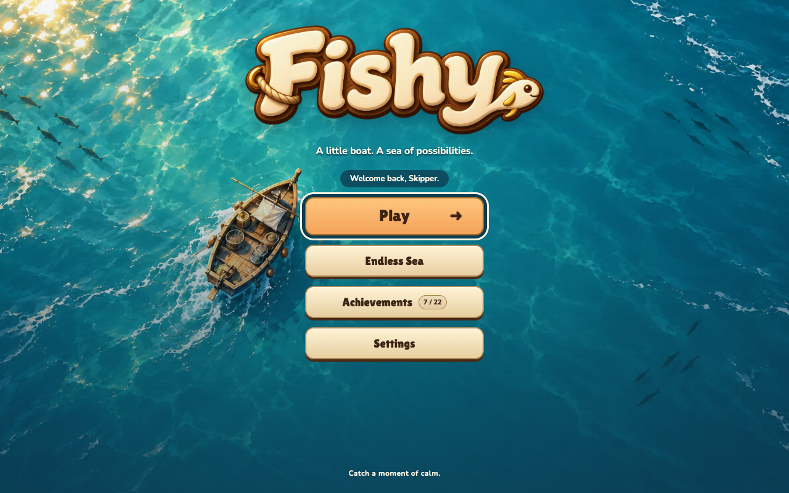
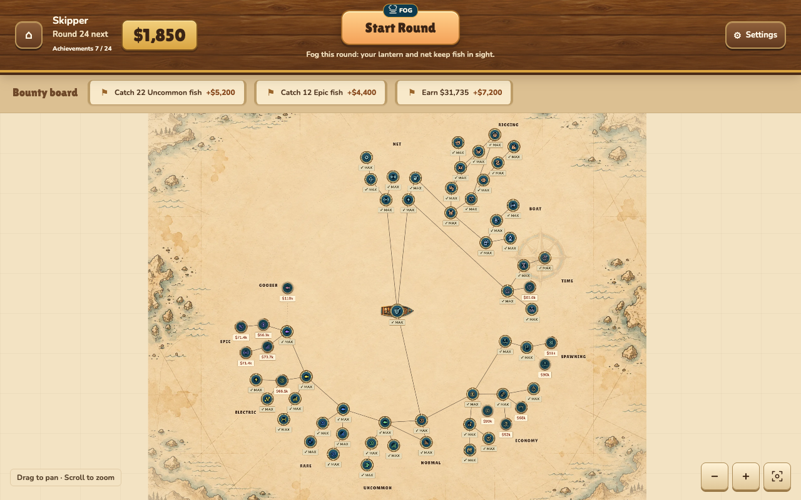
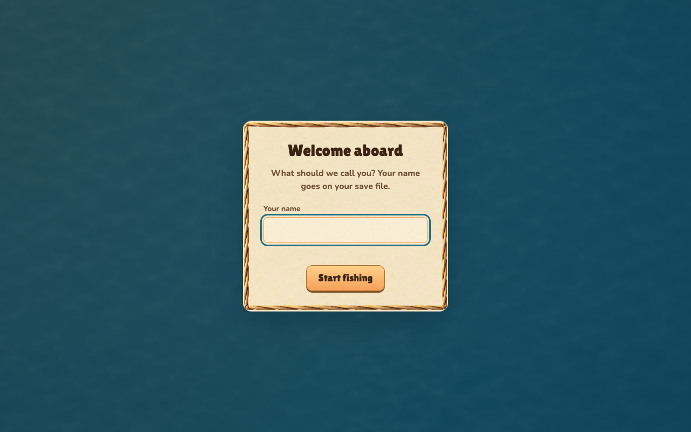
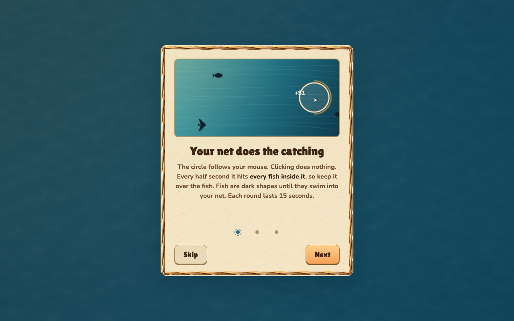
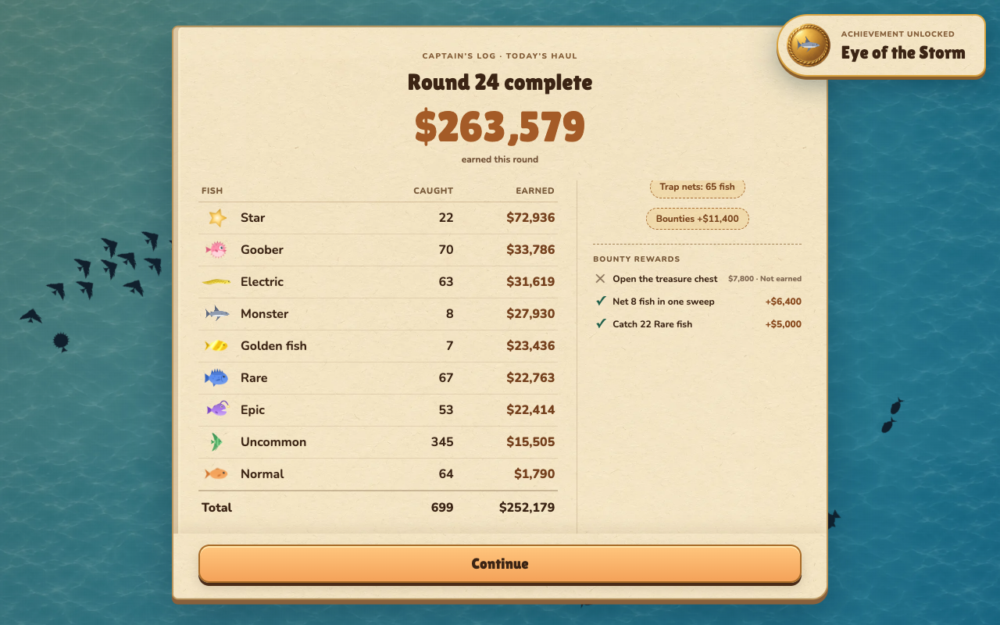
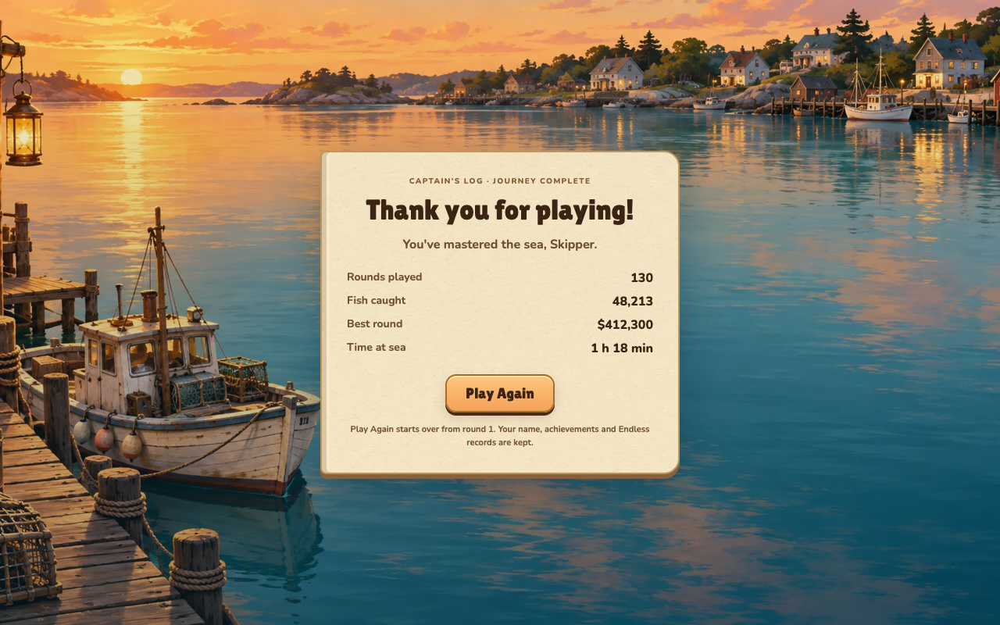
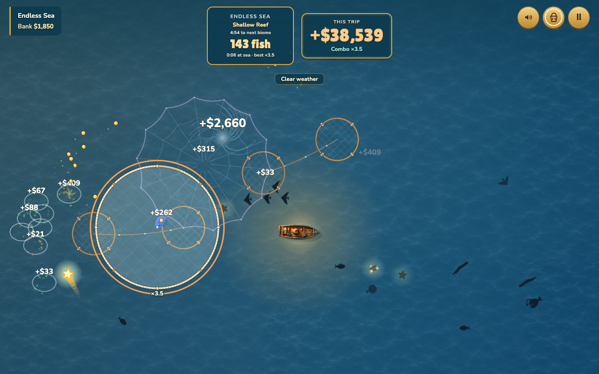
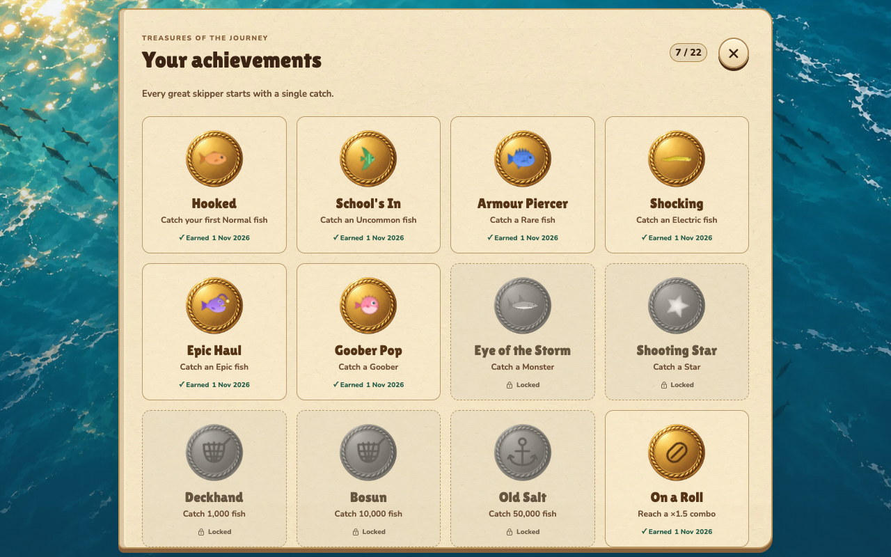

# Fishy

A round-based fish catching game for the browser. A boat sits in the middle of the sea and fish
swim around it. Guide a net that catches fish on its own; spend what you earn on
upgrades between rounds, take on bounties for extra money, unlock stranger fish, and work your way
to the Final Round. After your first round the Endless Sea opens: the same sea with no clock.

**Play:** https://fishy.vaibhavsomani.com/ (desktop and mobile browsers)



## How to play

- **Start at the title screen.** **Play** carries on your game, **Endless Sea** opens the sandbox
  (once you've played your first round), **Achievements** shows your badges and **Settings** holds
  help, sound, display and save tools.
- **Move the mouse.** The circle around the cursor is your net. Every half second it hits every
  fish inside it. Clicking does nothing.
- **On a phone or tablet, hold and drag.** The net floats above your finger so you can see the
  fish. Lift your finger to deactivate it. Portrait and landscape both work; rotating during a
  round pauses it so you can settle into the new view.
- **Catch fish.** A fish whose health reaches zero is caught and pays out.
- **Beat the clock.** Each round lasts 15 seconds. Whatever you caught is banked when the timer
  runs out; fish still swimming are lost.
- **Look through the net.** Outside the net every fish is a dark silhouette, told apart by its
  outline. Inside the net you see it in full colour, with its health bar.
- **Upgrade.** Between rounds you're in the hub. Spend money in the tech tree: a bigger net,
  harder hits, faster ticks, longer rounds, new fish and their abilities. Drag to pan; use the
  mouse wheel or pinch to zoom. On touch screens, tap an upgrade to inspect it, then tap **Buy**.
  The ⌂ button goes back to the title screen.
- **Take on bounties.** From round 2 the hub posts two or three challenges for the next round,
  each paying extra if you complete it. See [Bounties](#bounties).
- **Pause.** Use the pause button (or press Esc) during a round, then **Resume round** when ready.
  The round also pauses when you leave the tab or app, so you won't lose time in the background.
- **Finish.** Max out the whole tree to unlock the Final Round.
- **New here?** First-time players get a three-slide walkthrough before the title screen. Open
  **Settings → How to play** to see it again.
- **Sound.** Press **M**, or the speaker button, to mute. **Settings**, on the title screen or in
  the hub, has music and effects volume.
- **Watch your progress.** Time left and this round's earnings sit front and centre, with the
  bounty checklist to one side. The timer highlights the last five seconds; reduced motion
  disables its pulse.





| First visit | How to play | After a round | The end |
| --- | --- | --- | --- |
|  |  |  |  |

## Fish

| Fish | What it does |
| --- | --- |
| Normal | The fish you start with. Steady and simple. |
| Uncommon | Swims in small schools, so one sweep can catch several. |
| Rare | Slow and armoured, but worth a lot. |
| Electric | Darts around. When caught, a current jumps from fish to fish, damaging each one. |
| Epic | Swims away from your net. When caught, it can net the fish around it. |
| Goober | Bursts into new fish when caught. Upgrades decide which kind. |
| Monster | A whirlpool: pulls nearby fish into a vortex, and when caught takes all of them with it. |
| Star | Rare. When caught it shoots across the sea, bouncing off the edges and hitting every fish in its path. |

A fish caught by any of these effects counts as caught by you, so its own ability fires too and
chains can run through the whole sea.

## Surprises

| What | When | What it does |
| --- | --- | --- |
| Golden fish | From round 2 (from the start in the Endless Sea), about one every 17 seconds | A gold copy of any fish, worth 10×. It sparkles even as a silhouette, flees your net, and dives away after 8 seconds. |
| Treasure chest | Some rounds from round 3; always in the Final Round and when a bounty asks for one; every 60–100 seconds in the Endless Sea | Floats across the sea. Break it open with your net for a big payout, plus extra time or a spill of golden fish (always golden fish in the Endless Sea). |
| Feeding Frenzy | Every fifth round, the Final Round, and every 90 seconds in the Endless Sea | A wave of fish sweeps across the sea. For a few seconds fish spawn much faster and every catch pays 1.5×. The hub warns you before the round. |

Upgrades in the tree make each of them come more often, last longer or pay more.

## Bounties

From round 2 the hub shows a bounty board for the next round: two bounties, and three from round 8.
There are none in round 1 or the Final Round. Each completed bounty pays its reward on top of the
round's earnings; a missed one just pays nothing.

| Bounty | For example | Offered |
| --- | --- | --- |
| Catch some of one fish type | Catch 20 Rare fish | Any unlocked type |
| Reach a combo | Reach combo ×1.5 | Once the Combo upgrade is bought |
| Net many fish in one sweep | Net 8 fish in one sweep | Always |
| Earn an amount | Earn $31,162 | After your first earnings: 110–130% of your last round |
| Catch a golden fish | Catch a golden fish | From round 2 |
| Open the treasure chest | Open the treasure chest | From round 3 |
| Catch fish in the wave | Catch 40 fish in the Feeding Frenzy | Frenzy rounds |

- Targets come from your current upgrades, so every bounty can be done in one round. A board can
  hold two catch bounties for different fish; every other kind appears at most once.
- A reward is 15–30% of what you earned last round, more for harder bounties.
- A chest bounty guarantees the round a chest, arriving in its first 40%. If a golden fish bounty
  is on the board and none has appeared 35% of the way through the round, one swims in.
- The board is stored in your save and rolled from it, so reloading or buying upgrades doesn't
  change it.
- The hub lists the board under the top bar. In the round a checklist under the round number shows
  progress, and finishing a bounty plays a chime (with a small shake, and a buzz on phones). The
  summary ticks off each one and adds a "Bounties +$…" line to the round's total.

## Endless Sea



Play your first round to unlock it, then open it from the title screen. It's a sandbox with your
current upgrades and no clock:

- Fish keep coming, up to 80 swimming at once; golden fish and Frenzy pour-ins may go up to 40
  over that, so a full sea still gets its surprises. Time bonuses are off.
- A Feeding Frenzy wave comes 45 seconds in, then every 90 seconds, from alternating sides.
- A treasure chest floats in every 60–100 seconds (the next one waits while one is still out) and
  always spills golden fish. Golden fish appear from the start.
- There are no bounties.
- Every four minutes the light goes round from golden hour through dusk, night and dawn. At night
  the water darkens and a lantern glows around the boat. It's only for looks.
- The HUD shows fish caught, time at sea, your best combo and the trip's earnings.
- Nothing you earn here goes to your bank, and your money, round and upgrades stay as they were.
  Fish, golden fish, chests and records still count towards lifetime stats and achievements.
- To leave, pause and choose **End trip**. The logbook shows the trip's earnings, fish,
  time and best combo, and marks any new personal record: best session earnings, most fish
  caught, longest trip, best combo. **Keep fishing** starts another trip; **Head home**
  returns to the title screen.

## Achievements



There are 22, shown from the title screen or the hub's Achievements count under your name. Earned
badges show the date; locked ones say what to do. New ones pop up with a short brass fanfare when a
round or Endless trip ends.

| Achievement | How to earn it |
| --- | --- |
| Hooked | Catch your first Normal fish |
| School's In | Catch an Uncommon fish |
| Armour Piercer | Catch a Rare fish |
| Shocking | Catch an Electric fish |
| Epic Haul | Catch an Epic fish |
| Goober Pop | Catch a Goober |
| Eye of the Storm | Catch a Monster |
| Shooting Star | Catch a Star |
| Deckhand | Catch 1,000 fish |
| Bosun | Catch 10,000 fish |
| Old Salt | Catch 50,000 fish |
| On a Roll | Reach a ×1.5 combo |
| Unstoppable | Reach the highest combo your net allows: ×2, or more with Combo Cap upgrades (up to ×4) |
| Full Net | Catch 10 fish in one net sweep |
| Star Struck | Hit 10 fish with one Star shot |
| Gold Fever | Catch 50 golden fish |
| Treasure Hunter | Open 10 treasure chests |
| Clean Sweep | Complete every bounty in a round |
| Bounty Hunter | Complete 25 bounties |
| Master of the Sea | Finish the Final Round |
| Lost at Sea | Spend 10 minutes in one Endless trip |
| Sea Legs | Spend 30 minutes in one Endless trip |

All but the bounty and Final Round badges can be earned in the Endless Sea too. Achievements are
worked out from your saved stats, so a save from before they existed gets the ones it already
qualifies for (first catches, fish totals, Master of the Sea) when it loads or is imported. Play
Again keeps every badge you've earned; the counts towards the rest start again with the new game.

## Accessibility

- **Colour-blind palette.** **Settings → Display → Colour-blind palette** switches every fish type
  to colours that stay distinct under protanopia, deuteranopia and tritanopia. Fish shapes differ
  too, and golden fish, chests and the Feeding Frenzy are marked by shape, motion and text, not
  colour alone.
- **Reduced motion.** When your system asks for less motion, the how-to-play slides show still
  pictures, the title backdrop and the light on the water hold still, the sea doesn't shake, coins
  don't fly to the HUD, catches skip their ripples, sparks and pull into the net, the summary shows
  its total straight away, and achievement pop-ups fade in place.
- **Haptics.** On phones that can vibrate, big catches, Star launches, Whirlpools, chests and
  finished bounties give a short buzz. Turn it off with **Settings → Display → Haptics**; the
  switch only appears where the browser supports vibration.

## Look and feel

Cozy and nautical: golden-hour light on a teal sea, a small wooden boat, and menus made of warm
wood, rope, brass and parchment. The hub's tech tree is drawn on a sea chart with brass medallions,
round summaries and Endless trips are written up in a captain's log, and the end screen is a harbour
at sunset. Titles, big numbers and buttons use Lilita One, everything else Nunito, both self-hosted
from `@fontsource` packages. The painted art and textures live in `public/art/`; see
[public/art/CREDITS.md](public/art/CREDITS.md).

## Saving

Progress is saved in your browser. Export your save to a file to move it to another browser or
computer, and import it there. The save is version 2; saves and exported files from before the
redesign (version 1) load and upgrade automatically, with the new stats and records starting at
zero. The next round's bounty board is part of the save, so a reload doesn't change it.

**Play Again**, on the end screen, starts a new game from round 1 and keeps your name, achievements
and Endless records. Sound, display and haptics settings are kept apart from the save: Play Again
and importing a save leave them as they are.

Full design: [docs/GAME_DESIGN.md](docs/GAME_DESIGN.md).

## Development

Requires Node 22.12+ (24 recommended, see `.nvmrc`).

```bash
npm install
npm run dev           # dev server at http://localhost:5173
npm test              # vitest
npm run typecheck     # the game, then the UI gallery (npm run typecheck:ui)
npm run build         # static site in dist/
npm run preview       # serve the build locally
npm run e2e           # play through the whole game flow in Chrome (needs Google Chrome)
npm run e2e:mobile    # Chrome touch/phone layout and pause regression checks
node scripts/feedback-e2e.mjs  # Settings, save status, HUD layout and countdown across screen sizes
node scripts/tech-tree-e2e.mjs # Upgrade progress and desktop/mobile purchase controls
npm run screenshots   # regenerate docs/screenshots (needs Google Chrome)
```

Tech tree pacing: `PACING=1 npx vitest run src/game/tech/pacing.test.ts --silent=false` plays a
whole game with a bot and reports how long the tree takes to finish.

In dev, `?fish=electric,epic` makes only those types spawn, which is handy for trying one out:
http://localhost:5173/?fish=electric,epic. `?time=0.5` holds the Endless Sea at one time of day
(0 golden hour, 0.25 dusk, 0.5 night, 0.75 dawn).

Dev-only pages for working on one screen at a time:

- `/dev/tech-tree.html`: the tech tree (`?budget=N`, `?money=N`, `?fresh`).
- `/dev/save.html`: the save and its export/import, with buttons to play a round, play a
  10-minute Endless trip, buy an upgrade, start a new save and Play Again.
- `/dev/ui.html`: every screen with fixed sample data; it never writes a save. Pick a scene from
  its menu or by hash: `#title`, `#hub`, `#settings`, `#hud`, `#hud-endless`, `#hud-urgent`,
  `#frenzy`, `#pause`, `#summary`, `#endless`, `#achievements`, `#toast`, `#end`, `#name`,
  `#intro`, `#import`. The menu also switches the colour-blind palette.
- `/dev/render.html`: the renderer on a seeded late-round sea. `?still=1` holds a single frame for
  visual comparisons, `?live=1` runs the simulation, `?endless=1` uses an Endless trip,
  `?time=0..1` sets the time of day, `?fish=N` the number of fish (16–600, 80 at most in endless,
  96 by default), `?palette=colorBlind` the colour-blind palette, and `?title=1` shows the sea
  and boat with no fish. Its buttons fire a catch burst and time drawing 300 fish.

### Structure

```
index.html          Page shell: canvas, title screen, HUD, hub, panels
src/main.ts         Boot, game loop, input, screens (title, hub, round, summary, Endless logbook, end)
src/app/            Helpers for main.ts, tested
  bounties.ts       Keeps the bounty board stable; works out progress and payouts
  endless.ts        Endless unlock, time at sea, new personal records
src/game/
  world.ts          The simulation for one round or Endless trip. No DOM, fixed 60 Hz step, seeded RNG
  stats.ts          Everything upgrades can change (global, per fish, abilities) and base values
  bounties.ts       Bounty kinds, rolling a board, progress, labels and guarantees
  achievements.ts   The achievement list and which ones a save qualifies for
  golden.ts, chest.ts  Golden fish and treasure chests
  fish/             One file per fish type (FishSpec): stats, shape and behaviour hooks
    types.ts        FishSpec: onSpawn, move, modifyDamage, onCapture, update, onResize, drawWorld, fx
    index.ts        Registry of all types
  render.ts         Canvas renderer: painted sea, boat, silhouettes, net lens, catch feedback, day and night
  art.ts            Loads the painted sea and boat; the renderer draws its own until they arrive
  viewport.ts       Normalized arena and projection into the visible screen
  shapes.ts         Builds each type's cached full / silhouette / hit-flash sprites
  fx.ts             Short-lived visual effects, flying coins, caustics and shake
  palette.ts        Standard and colour-blind fish colours
  rng.ts            Seeded random numbers
  tech/             Tech tree: node definitions, applyUpgrades, costs, layout, pacing sim
src/save/           Save model (version 2), localStorage, validation (zod/mini), migrations, export/import
src/audio/          Music and sound effects (Web Audio); see "Music and sound" below
  index.ts          What main.ts calls: screens, purchases, bounties, achievements, each frame's world events
  engine.ts         AudioContext, mixing graph, unlock on first gesture, mute/volume, hidden tab
  music.ts          The continuous bed (loop file or generated), filter, layers, chapters, stinger
  dynamics.ts       Countdown urgency and each screen's mix
  sfx.ts            Synthesised sound effects with rate limiting
  synth.ts          Small instruments built from oscillators and noise
  loader.ts         Fetches public/audio/music.json and decodes loop files
  theory.ts, patterns.ts, mapping.ts, manifest.ts, settings.ts, gate.ts   Pure logic, tested
src/ui/             Tech tree, name prompt, how-to-play, save, sound and display controls
  bounties-view.ts      Bounty board, HUD checklist and summary list
  achievements-view.ts  Badge grid
  achievement-toast.ts  Queued "Achievement unlocked" pop-ups
  icons.ts              Shared SVG icons
public/art/         Painted art and textures (see CREDITS.md)
public/audio/       Music manifest (and loop files, once chosen)
dev/                Dev-only pages: tech tree, save, UI gallery, renderer review
scripts/
  e2e.mjs           Browser smoke test of the whole game flow
  mobile-e2e.mjs, feedback-e2e.mjs, tech-tree-e2e.mjs   Phone layout, Settings and HUD, tech tree checks
  screenshots.mjs   Captures the README screenshots
```

### Music and sound

Everything plays through Web Audio. Browsers only allow sound after a click or key press, so the
`AudioContext` is created on the first one (the name prompt for a new player, any click on the
title screen for a returning one). It is suspended while muted and while the tab is hidden.
Settings (`{ muted, music, sfx }`) live in localStorage under `fishy.audio`, apart from
`fishy.save`.

Everything is in one key and tempo, D major pentatonic at 124 BPM, so any note fits with any
other:

- **Music** is one continuous bed that never restarts. Each screen sets its mix:
  - **Title:** the bed on its own, low-passed (1.4 kHz) and about 4 dB down.
  - **Hub** and round summary: low-passed (700 Hz) and 6 dB down, as if from under water, with a
    sparser melody.
  - **Round:** starting a round sweeps the filter open into the next downbeat, where a driving
    groove comes in: four-on-the-floor kick, claps on 2 and 4, off-beat open hats, a sixteenth-note
    shaker and a syncopated bass line. The melody gets busier, and a combo layer (an arpeggio)
    follows the combo multiplier.
  - **Last five seconds:** an accented sixteenth-note hat roll and a rising swell of noise build
    towards the end.
  - **Feeding Frenzy:** a bright lead an octave above the arpeggio and a tambourine on every
    sixteenth, for as long as the wave runs.
  - **Final Round:** everything open, with some of the combo layer always playing.
  - **Endless Sea:** a gentler mix for long trips: the groove without claps, a little quieter and
    filtered, no countdown, and a melody whose density shifts every 16 bars.
  - A round (or Endless trip) ends with a one-bar stinger while the layers drop and the filter
    closes. The end screen is unfiltered and calm.
- **Chapters**: three beds, switched in the hub with a 3 s crossfade on a bar line: Shallows from
  the start, Currents once Electric fish are bought, Deep once the Monster is.
- **Until loop files are added**, each chapter plays a generated bed: a warm pad and a melody
  (steel drum in the Shallows, kalimba in the Currents, marimba in the Deep) whose notes are drawn
  bar by bar from seeded random numbers, so it never repeats as a loop.
- **Sound effects** are synthesised: a catch is a marimba pluck that climbs the scale with the
  combo, an Electric current rises one note per jump, a Star launches with a whoosh and bounces
  with a glass ping, a Whirlpool implodes with a noise swirl, a Goober bursts with a pop, time
  bonuses ring a tiny bell and purchases chime. A finished bounty plays three bright notes and a
  bell; an achievement plays five soft brass notes and a shimmer. Each kind is rate-limited
  (catches to one note per 40 ms, at most 8 voices at once), and many catches in one frame become
  one fuller note.
- **Mix**: music and effects each have a volume, then master (mute), a compressor and a soft clip.
  Levels were last measured in headless Chrome before the move to 124 BPM: at default volumes a
  quiet round measured about −28 dBFS RMS and the busiest late round peaked around −4 dBFS, and
  the Final Round with both sliders at 100% peaked at −1.6 dBFS. Measure again after changing the
  mix.

#### Adding the loop files

The real beds are CC0 loops (e.g. from the Abstraction Music Loop Bundle), one per chapter.

1. **Pick and trim.** Choose three loops that work at a similar level. Note each one's tempo
   (BPM), key, and beats per bar. Different tempos and keys are fine: the generated layers and the
   sound effects follow whatever the manifest says.
2. **Encode** to Opus, plus AAC as a fallback for browsers that can't decode Opus (some Safari
   versions):

   ```bash
   ffmpeg -i shallows.wav -c:a libopus -b:a 96k public/audio/shallows.opus
   ffmpeg -i shallows.wav -c:a aac -b:a 128k public/audio/shallows.m4a
   ```

3. **Find the loop points.** A loop plays from the start of the file once, then repeats
   `loopStart`..`loopEnd` forever. `loopStart` must be on a downbeat: usually `0`, or where the
   repeating part begins if the file has an intro (in Audacity, set the selection toolbar to
   seconds and click the first beat of the repeat). Always give `loopEnd` explicitly, worked out
   from the music rather than the file length, because encoders pad the end of compressed files:
   `loopEnd = loopStart + bars × beatsPerBar × 60 / bpm`, e.g. 8 bars of 4/4 at 124 BPM from 0 is
   `15.4839`. The game nudges its own tempo so the loop is exactly a whole number of bars, so the
   layers stay locked to it.
4. **List them** in `public/audio/music.json`. Paths are relative to that file. A chapter left
   out or `null` keeps the generated bed:

   ```json
   {
     "chapters": [
       {
         "name": "Shallows",
         "files": ["shallows.opus", "shallows.m4a"],
         "loopStart": 0,
         "loopEnd": 15.4839,
         "bpm": 124,
         "beatsPerBar": 4,
         "key": "D major",
         "gainDb": 0
       },
       null,
       { "name": "Deep", "files": ["deep.opus", "deep.m4a"], "loopEnd": 23.2258, "bpm": 124, "key": "B minor" }
     ]
   }
   ```

   | Field | Meaning |
   | --- | --- |
   | `files` | The same loop in several formats, best first. The first one the browser can play is used. An entry can be an object `{ "src", "type", "loopStart", "loopEnd" }` to give one file its own loop points, e.g. if the AAC fallback clicks at the seam because its decoder kept the encoder delay. |
   | `loopStart`, `loopEnd` | Seconds. Default `0` and the end of the file. |
   | `bpm`, `beatsPerBar` | Default 124 and 4. |
   | `key` | Like `"D major"` or `"F# minor"`; default D major. The groove, combo layer and sound effects play in its pentatonic scale. |
   | `gainDb` | Level trim so loops from different packs match; default 0. |
   | `layers` | Optional `{ "groove": [files], "combo": [files] }`: stems the same length as the bed that replace the generated groove or combo layer. In the Endless Sea a groove stem is muted and the generated groove (without claps) plays instead. |

5. **Listen.** `npm run dev`, click once, and play through a round. Problems with the manifest show
   up as console warnings starting `Fishy music:`. Only the current and next chapter are loaded,
   after the first click, and decoded audio is large (about 20 MB per minute of stereo), so keep
   loops under a minute or so.

**Credits.** CC0 needs no credit, though a line here is a kind touch: `Music: <pack> by <artist>
(CC0)`. If a track under any other licence is ever used (e.g. CC BY), it must be credited here,
for example: `"<title>" by <artist> (<link>), licensed under CC BY 4.0
(https://creativecommons.org/licenses/by/4.0/).`

### Deploy

Every push to `main` runs the tests, builds, and deploys `dist/` to GitHub Pages
(`.github/workflows/deploy.yml`). The repo's Pages source must be set to "GitHub Actions".

Saves live in the browser's localStorage, which is tied to the site's exact origin. Changing the
domain later means players have to export and re-import their saves.
